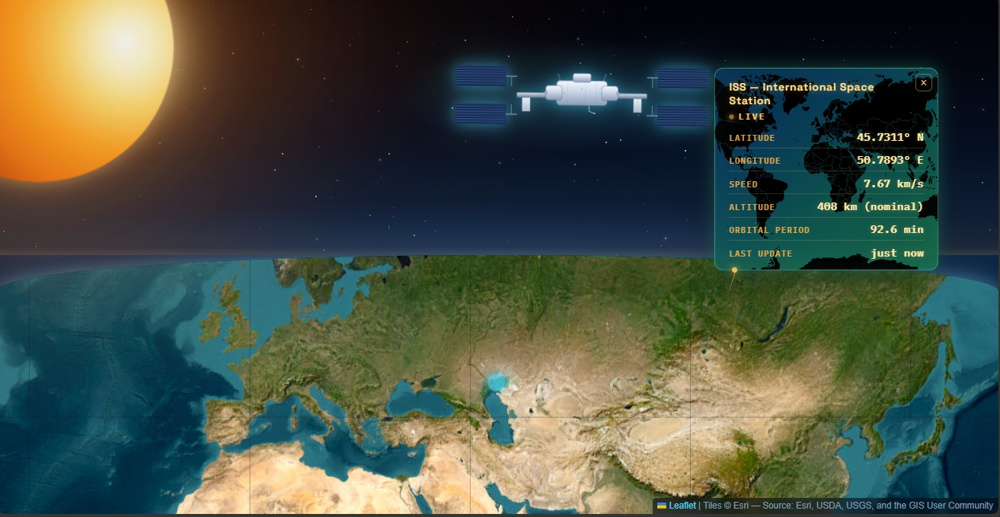

# ISS Tracker

A cinematic live tracker for the International Space Station — real-time telemetry on a satellite view of Earth.

**Status:** Phase 4 complete — full polish pass done. Ready for cross-device testing and public deployment.

**Live demo:** https://shlokchauhancs.github.io/iss-tracker/

**Tech stack:**
- HTML, CSS, JavaScript (vanilla)
- Leaflet.js + Esri World Imagery satellite tiles
- Open Notify + WhereTheISS.at APIs
- Google Fonts: Space Grotesk + IBM Plex Mono

**Features:**
- Cinematic space scene with distant sun, starfield, and Earth's horizon
- Realistic ISS SVG that slides across the sky by real longitude (amplified 12×)
- Full-color satellite map that recenters on the ISS every 5 seconds
- Live ISS coordinates via Open Notify, with WhereTheISS.at as fallback
- Orbital physics computed in real time (vis-viva equation) for velocity and period
- Compact telemetry panel with live stats: lat/lon, speed, altitude, period, last-update ticker
- Loading, live, stale, error, and offline states handled gracefully
- Mobile-responsive layout
- Accessibility: reduced-motion support, ARIA labels, keyboard-accessible ISS
- Respects browser cache and tab throttling via visibilitychange handling

**How it works:**
1. Page loads → Leaflet map and space scene initialize.
2. `setInterval` fires every 5 seconds.
3. `fetch()` pulls current lat/lon from Open Notify (falls back to WhereTheISS.at on failure).
4. Marker moves to live position; map pans smoothly to keep the ISS centered.
5. ISS SVG slides horizontally based on longitude (amplified for visibility).
6. Physics module computes orbital velocity and period from current altitude.
7. Panel updates live stats and a "seconds ago" ticker.

**Physics reference:**
- Gravitational parameter: `GM_earth = 3.986 × 10¹⁴ m³/s²`
- Earth radius: `R = 6,371 km`
- Nominal altitude: `408 km` (live altitude when WhereTheISS.at is the source)
- Orbital radius: `r = R + altitude`
- Velocity: `v = √(GM_earth / r)` ≈ 7.66 km/s
- Period: `T = 2π × √(r³ / GM_earth)` ≈ 92.7 min
- Distance per tick: `v × 5s` ≈ 38.3 km

**Known limitations:**
- Open Notify provides only lat/lon, so altitude is labeled "nominal" when it's the data source.
- Background tabs throttle `setInterval` — expected browser behavior; the tracker refetches on tab return.
- Sky movement is visually amplified (12×) so the slow real orbital motion is perceptible.

**What's next:**
- Phase 5: cross-device and cross-browser testing
- Phase 6: deploy to GitHub Pages
- Phase 7: final portfolio polish (screenshot, README refinements, pin repo)